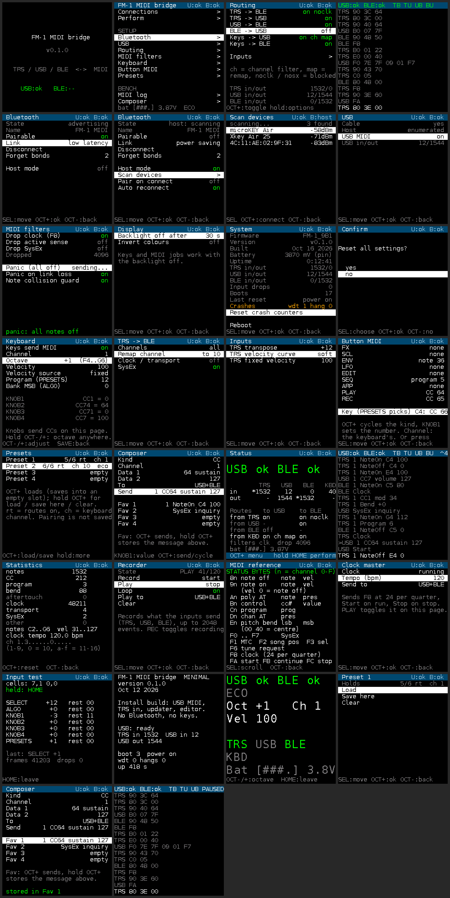

# fm1-midi-bridge

Firmware that turns the M-VAVE FM-1 into a MIDI bridge:

- **TRS MIDI IN -> Bluetooth LE MIDI** (the FM-1 as a BLE MIDI peripheral a phone,
  tablet or computer connects to)
- **BLE MIDI -> USB MIDI** and **USB MIDI -> BLE MIDI** (the FM-1 plugged into a
  computer as a class-compliant USB MIDI device)
- later, maybe: the FM-1 as a BLE *central* that pairs with a BLE keyboard and
  forwards it to USB

The FM-1 has **no TRS MIDI OUT**: the 3.5 mm jack is MIDI IN only (see
`docs/hardware.md`). So "BLE -> TRS" is not possible without a hardware mod;
"BLE -> USB" is the reverse direction this project targets.

Status: **runs on the first FM-1 since 2026-10-19** (`docs/recovery.md`, "The bridge on the
first unit"): the full build boots, shows its UI on the panel, enumerates on USB, advertises BLE
MIDI, takes keys, buttons and knobs, carries BLE MIDI from a phone to USB, and installs and
uninstalls through its own update entry. TRS MIDI in and the USB/TRS to BLE directions are
still to be exercised on the unit. The MIDI codecs, the router and the update entry pass host tests.

## Build

```
sh tests/run_tests.sh                     # host tests, needs cc
ulimit -n 8192 && make -C app -j8         # build/fm1bridge.elf and build/app.bin
```

`make SDK=... TOOL_DIR=...` overrides the SDK checkout and toolchain locations.
```
sh tools/package.sh            # build/fm1bridge.fwsc (needs Felucca built next door, for its loader)
sh tools/install.sh --info     # identity of a connected FM-1
sh tools/fm1_safe_install.sh build/fm1bridge.fwsc   # install (docs/recovery.md); tools/install.sh is the bare installer
```

The first thing to flash on a real unit is the **minimal build**: no radio, no key
matrix, no UI task, just USB MIDI, TRS in, the updater, the editor and the log.
Identity `FM-1_930`, so `--info` tells it apart.
```
make -C app -j8 MINIMAL=1      # build/minimal/app.bin
sh tools/package.sh --minimal  # build/fm1bridge-minimal.fwsc
```

Before and after anything goes on hardware, read `docs/recovery.md`. The parsers
that run in the bridge task, and the bridge task itself on a host simulator, are
fuzzed under ASan/UBSan with `sh tests/fuzz/run_fuzz.sh` (a couple of minutes;
`sh tests/fuzz/soak.sh` for a long run with a fresh seed). `tools/fm1_recover.py` puts a
device that still enumerates into the mask-ROM download mode; `tools/fm1_flash.sh`
dumps and restores the whole flash from there through jl-uboot-tool.

## Why not a Felucca fork

Felucca and its forks are bare-metal GPL-3 firmwares that never enable the radio.
The JieLi Bluetooth stack ships only as closed `.a` libraries on FreeRTOS, which a
GPL firmware cannot link (hugelton/Felucca issue 17). This project therefore builds
on the vendor **AC79 AIoT SDK** (Apache-2.0 sources + proprietary binary libs),
starting from its `demo_ble` application, and uses Felucca only as a *reference*
for the FM-1 pin map and the update protocol. No Felucca code is copied.

## Layout

| Path | What |
| --- | --- |
| `docs/hardware.md` | FM-1 board facts: SoC, pins, jacks, flash map |
| `docs/update-protocol.md` | how firmware gets onto the FM-1 over USB-MIDI SysEx, and what our app must keep |
| `docs/ble-midi.md` | the BLE MIDI 1.0 service, packet format and timing |
| `docs/plan.md` | milestones, open questions, things to verify once an FM-1 is here |
| `docs/manual.md` | the user manual: what the device does, every page, updating, limits |
| `docs/sdk-notes.md` | what the AC79 SDK provides and how we use it (build, update, BLE, USB, UART) |
| `docs/recovery.md` | why the FM-1 is hard to brick, what to do before the first install, the recovery ladder |
| `app/` | the SDK application: `Makefile`, `app_main.c`, `board/`, `bt_ble/`, `include/` (derived from the SDK's `demo_ble`, Apache-2.0) |
| `app/midi/` | transport-independent MIDI code: byte-stream parser, BLE MIDI packet codec, USB-MIDI event codec, routing matrix (MIT) |
| `app/usb/` | USB-MIDI device class on the SDK USB stack, and the SDK composite-device file with a MIDI branch (Apache-2.0) |
| `tools/fm1pkg_make.py` | our fork of Felucca's packager (GPL-3 build tool): VM region ends at 0xE0000 |
| `tools/package.sh`, `tools/install.sh` | packaging with the fork, install with Felucca's installer (external GPL tool) |
| `tools/fm1_safe_install.sh` | the first install on a unit: identity, soft key, full dump and survey, then the install |
| `tools/fm1_install_paced.py` | the installer with the host's SysEx paced (for a firmware whose USB ring is too small for a reply) |
| `tools/fm1_editor.py` | the web editor's questions from the shell: info, counters, heap and stack margins, the device log |
| `tools/dongle/` | the mask-ROM USB key: `stm32f4disco/` (verified on the first unit), `fm1_key.py` (RP2040 MicroPython, untested) |
| `tools/mkapp.sh` | ELF -> `app.bin` (the four sections the SDK packer concatenates) |
| `tools/fm1_recover.py`, `tools/fm1_flash.sh` | soft key / vendor request into the mask-ROM download mode; whole-flash dump and restore through jl-uboot-tool |
| `tools/mkfont.py` | renders DejaVu Sans Mono into `app/ui/font.h` (8x14, 1 bpp) |
| `tools/gatt_midi.py` | generates `app/bt_ble/midi_profile.h`, the ATT database of the BLE MIDI service |
| `tools/ui_walk.py` | walks every UI page in fm1-emu's live tool with key scripts; a decode gap shows as a halt, pictures in `build/ui_walk/` |
| `app/bridge.c` | the bridge task: ports -> parser/decoders -> router -> encoders |
| `app/fm1_log.c`, `app/util/logring.c` | the device log: 4 KB RAM ring, the SDK log hook, read over SysEx by the web editor (MIT) |
| `app/minimal.c` | the first-install build's status task (`make MINIMAL=1`) |
| `app/ui/` | panel driver, UI task, menu renderer, pages and the MIDI logger; `font.h` generated by `tools/mkfont.py` (MIT) |
| `app/input/` | front-panel matrix scanner (14 buttons, 7 encoders, 27 keys, LEDs) on TIMER3 (MIT) |
| `app/settings.c` | persistent settings in the SDK's syscfg (MIT) |
| `app/bt_ble/ble_host.c`, `ble_port.c`, `adv_parse.c` | BLE host mode (scan, connect to a BLE MIDI device), the bridge's BLE port layer |
| `web/editor.html` | settings editor in the browser over USB-MIDI SysEx (Web MIDI); see `docs/web-editor.md` |
| `docs/ui-examples/` | example screenshots of every page (`tools/ui_mock.py`) |
| `app/update/` | update step 1 over USB-MIDI SysEx (portable core + SDK port), soft key to recovery (MIT) |
| `tests/` | host tests: MIDI codecs, router filters, panic, update sessions (both identities, full -> minimal -> full), settings, matrix decoder, advertising parser, editor and log ring, the bridge task (`sh tests/run_tests.sh`) |
| `tests/host/` | the bridge task's host simulator: SDK header stand-ins and RAM ports, shared by `tests/test_bridge.c` and the bridge fuzz harness |
| `tests/fuzz/` | ASan/UBSan fuzz harnesses for the MIDI decoders, pack7, the editor, the update entry and the whole bridge task (`sh tests/fuzz/run_fuzz.sh`; `soak.sh` for long runs, e.g. from cron) |
| `build/` | build output (ignored) |

## UI

Splash, then a main menu: Routing, MIDI log, Bluetooth, USB, MIDI filters, Display,
System (with Input test). SELECT or PRESETS scrolls, OCT+ is OK or toggle, OCT- goes
back, HOME returns to the main menu, KNOB1 adjusts a value, holding GLO toggles BLE
power saving. Example screenshots, rendered from the real font and layout rules by
`tools/ui_mock.py`:



## Footprint (build of 2026-10-16)

| | full build | minimal build | of |
| --- | --- | --- | --- |
| `app.bin` (flash) | 364,256 B (356 KB), 63% | 205,296 B (200 KB), 35% | 581,564 B app slot |
| `.text` | 347,872 B | 191,200 B | |
| static RAM, initialised (`.ram0_data`) | 16,352 B | 14,064 B | includes the matrix ISR code copied to RAM |
| static RAM, zeroed (`.ram0_bss`) | 80,608 B | 69,072 B | ours plus the SDK's |
| static RAM total | 96,960 B (95 KB) | 83,136 B (81 KB) | 512 KB internal RAM; the rest is SDK heap, Bluetooth and task stacks |

Largest things of ours in RAM: the recorder (2048 events, 16 KB), the device log
ring (4 KB), the two note collision guards (4 KB), the panel text strip (6.7 KB),
the MIDI log rings (64 lines, 6 KB), the BLE host and peripheral ATT buffers (about
1.5 KB each), the update staging buffers (3 KB) and the message queues between tasks
(2 KB). The 16x28 font of the Perform page is 5.3 KB of flash (the minimal build
drops it). The bridge and UI tasks each get a 1024-word stack; the minimal build's
status task 768 words. For comparison, the SDK's bare BLE demo is 283 KB of flash
and 25 KB of static RAM, so the whole bridge, UI and learner feature set costs about
60 KB of flash and 65 KB of RAM on top of the stack. The minimal build still links
the Bluetooth libraries (their static buffers are most of its RAM) but never starts them.

Reproduce: `objdump -section-headers build/fm1bridge.elf` with the JieLi toolchain,
and `ls -l build/app.bin`.

## Dependencies

- JieLi AC79 AIoT SDK, tag `AC79NN_SDK_V1.2.1_2023-12-13`, full checkout
  (`~/fw-AC79_AIoT_SDK`; the Felucca build used a sparse checkout of 3 files)
- JieLi pi32v2 clang toolchain (`~/.jieli/toolchain`, installed by Felucca's
  `tools/get_toolchain.sh`), Linux x86-64
- Python 3 with `mido` + `python-rtmidi` for the installer and the soft key;
  `pyusb` for `tools/fm1_recover.py --vendor`; kagaimiq's jl-uboot-tool (MIT,
  cloned next to this tree) for `tools/fm1_flash.sh`
- clang with ASan/UBSan for `tests/fuzz` (any C compiler for `tests/run_tests.sh`)

## References

- Felucca (GPL-3, hugelton): https://github.com/hugelton/Felucca — HAL headers
  document the FM-1 registers and pins; `tools/fm1pkg_make.py` documents the
  `.fwsc` package format; issue 17 explains the Bluetooth situation
- aroum/fm1-custom-fw: reverse engineering of the stock updater and SysEx protocol
- ip2k/mvave-fm1-open-firmware: RP2040 UBOOT recovery dongle
- kurogedelic/FM-1-transporter: recovery tool
- JieLi AC79 SDK: https://gitee.com/Jieli-Tech/fw-AC79_AIoT_SDK
- BLE MIDI spec: MIDI Association, "MIDI over Bluetooth Low Energy" 1.0 (2015)
