# FM-1 MIDI bridge: user manual

This firmware turns the M-VAVE FM-1 into a MIDI bridge and a small controller. It
replaces the synthesizer firmware; the keys, knobs, buttons, screen, USB port,
Bluetooth and the 3.5 mm MIDI input all stay in use, the sound engine does not.
M-VAVE's own updater puts the original firmware back at any time.

## What it does

- **TRS MIDI IN** (the 3.5 mm jack, input only on the FM-1) is forwarded to USB and to
  Bluetooth.
- **USB MIDI** (the USB-C port, class compliant, no driver) is forwarded to Bluetooth,
  and Bluetooth to USB.
- **Bluetooth MIDI**: phones, tablets and computers connect to the FM-1, or, in host
  mode, the FM-1 connects to a Bluetooth MIDI keyboard.
- **The FM-1's own keys and knobs** send notes and control changes.
- **Buttons and keys** can send a note, a control change or a program change, for
  example to turn pages in a sheet-music app.
- **A MIDI bench**: a log that decodes what passes, a composer that sends any message
  by hand, statistics of what a device sends, a recorder with replay, a clock master
  and a built-in reference. Good for learning MIDI with real gear on both ends.

Every route can be switched on or off, filtered by channel, remapped to a channel,
and told whether to pass clock and SysEx.

## The panel

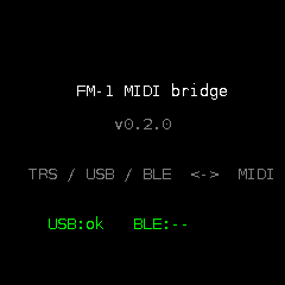

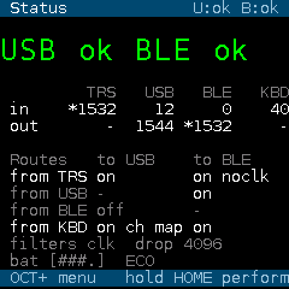

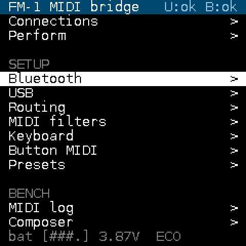

After the splash the screen shows the **Status** page: the two links in the big font,
the ports' counters and the routes as tables, between a title band and a footer band.
It is a dashboard, not a menu: nothing on it is highlighted or selectable. HOME or OCT+ there opens the main menu, HOME from anywhere
else comes back to it. The menu is in three groups, Setup, Bench and Device, and its
first two rows are the two status pages, Status and Perform.

The controls that drive every page are the same:

| Control | Does |
| --- | --- |
| SELECT encoder (or PRESETS) | moves the highlight up and down; it skips rows that are only information |
| OCT+ | OK: enters a page, toggles a switch, cycles a choice, confirms |
| hold OCT+ | a row's second action where it has one: a route's options, a preset's page, storing a favourite |
| OCT- | back, with the highlight where you left it |
| HOME | the Status page from anywhere (the menu, from Status) |
| hold HOME | the Perform page |
| KNOB1 | changes the highlighted value; a quick turn steps by 3, a flick by 10 |
| hold GLO | Bluetooth power saving on or off, from any page |

The other buttons and the 27 keys are free for MIDI jobs. The button LEDs mean:
HOME lit = the Status page; GLO lit = power saving on; REC blinks on USB traffic
and PLAY on Bluetooth traffic unless you gave them a MIDI job; a key or button lights
while it is held and sending.

The title row is a blue band, the highlighted row a white bar, so the two are never
confused. Every title row ends with the link status, "U:ok B:adv" for example: USB "ok" when
the computer has enumerated the FM-1, Bluetooth "ok" when a device is connected,
"con" while connecting, "adv" while advertising, "host" in host mode. A switch that is
on is green, one that is off is dim. Anything that needs attention (a low battery, a
crash counter above zero, dropped input events) is orange. An action that has no
visible effect of its own ("stored", "sent", "settings reset") says so on the bottom
line for a second.

The main menu's bottom line shows the battery as a bar of four cells, and "ECO" when
power saving is on. The steps are the ones Felucca and SLOOP use on the same reading:
four cells from about 3.95 V (a full charge), three from 3.8, two from 3.6, one from 3.4 V,
orange below that (estimates, not checked against a meter).

A question that cannot be undone (reset the settings, forget the pairings, reboot
into recovery) starts with the highlight on "no": turn SELECT up to "yes" and press
OCT+.

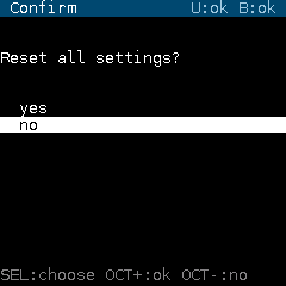

## Pages

### Status

The home page. USB and BLE in the big font, green when the link is up. Below, a
table of the four ports' counters, in and out, with a star on a counter that moved
since the last refresh (three a second). Then the six routes as a table, a row per
source and a column per destination, each cell the switch and a note of any option
set on the route ("ch" for a channel filter, "map" for a remap, "noclk" when clock is
blocked); an off route is dimmed. The last rows hold the global filters with the
dropped count and the battery. This is the page to look at when "nothing arrives":
it tells you which link is up and which route is off. OCT+ opens the menu.

### Perform

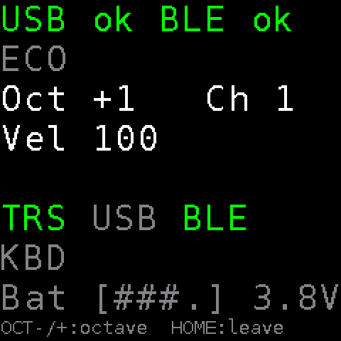

The stage page, in a font readable from a music stand: the USB and Bluetooth state,
"ECO" when power saving is on, the keyboard's octave and channel, its velocity, the
four ports lit green while something moves on them, and the battery. OCT- and OCT+
shift the octave here. Hold HOME on any page to get here; HOME leaves.

### Routing

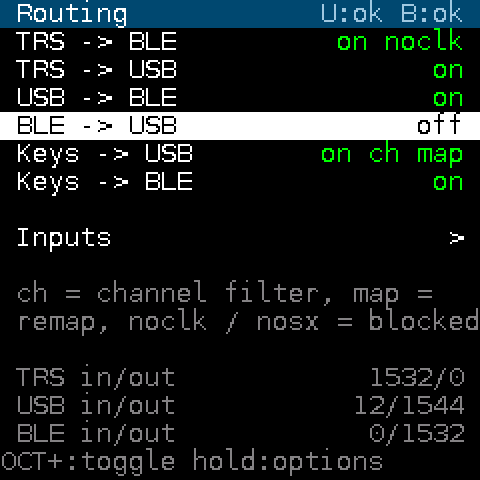
One row per route: TRS to BLE, TRS to USB, USB to BLE, BLE to USB, Keys to USB, Keys
to BLE. OCT+ switches a route; the row also shows what is set on it ("ch", "map",
"noclk", "nosx"). Hold OCT+ on a route to open its options. "Inputs" opens the input
transforms. Counters per port show messages in and out.

**Route options**

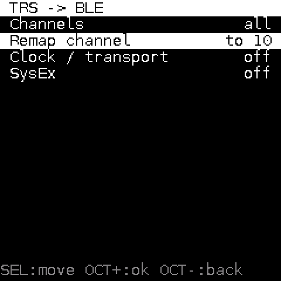
- *Channels*: all, or one channel only. (The web editor can choose any set.)
- *Remap channel*: keep, or force every channel message onto one channel.
- *Clock / transport*: pass or block clock, start, continue and stop. Clock over
  Bluetooth is jittery; blocking it on the BLE route and keeping it on USB is common.
- *SysEx*: pass or block. Large patch dumps are safer over USB.

**Inputs**

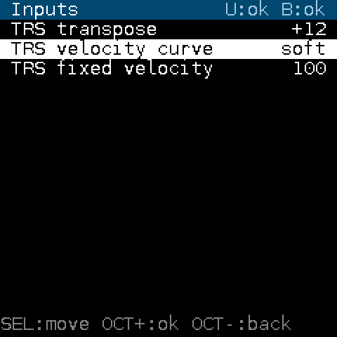
- *TRS transpose*: shifts incoming notes by semitones (-24 to +24).
- *TRS velocity curve*: linear, soft, hard or fixed; *fixed velocity* sets the value.

### MIDI log

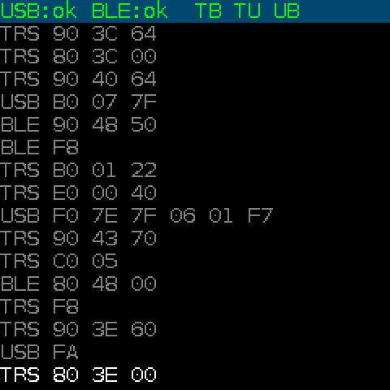
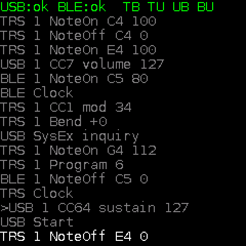

The last messages from any port, newest at the bottom; the screen shows sixteen and
the FM-1 keeps sixty-four. OCT+ switches between raw bytes and decoded text:
"1 NoteOn C4 100" is channel 1, note on, middle C, velocity 100; "1 CC7 volume 127"
names the controller; a line starting with ">" is something the Composer sent out.
SysEx shows its size, and a Universal Device Inquiry or its reply is recognised, the
reply with the manufacturer's name.

Turn SELECT up to read back through what has scrolled away: the status line then
shows "^N", how many lines you are behind the newest, and the view stays where it
is while new messages keep arriving underneath; turn back down to the newest line
and it follows again. Hold OCT+ to freeze the view ("PAUSED" on the status line),
hold it again to release. OCT- leaves.

Four buttons choose what the page lists: FX notes, SCL program changes, ENV control
changes, LFO everything else (clock, SysEx, pitch bend, aftertouch, system messages).
A button's LED is lit while its kind is listed; press it to hide that kind, again to
show it. With something hidden, the status line shows "show N P C O" in place of the
routes, a "-" for each kind hidden (hiding LFO is the way to read notes under a running
clock). Hidden messages still pass through the bridge, they are only not listed, and a
kind shown again appears from then on. The choice is kept across restarts. On this page
the four buttons do this even when they have a MIDI job on the Buttons page.

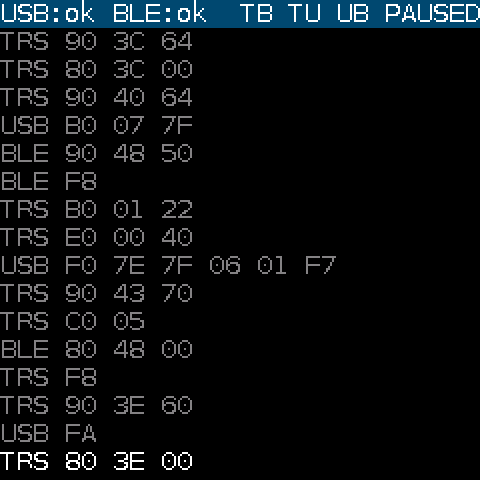

### Composer

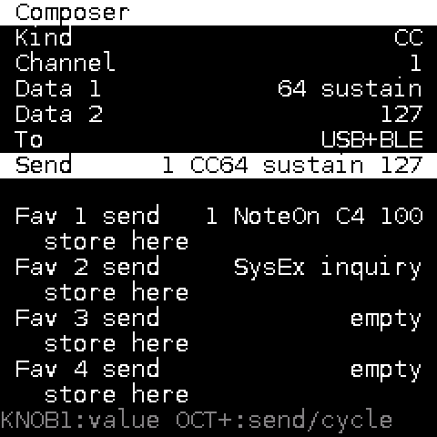

Builds one message and sends it, for trying things by hand. Pick the *Kind*: note,
control change, program change, pitch bend, channel or poly aftertouch, clock,
start, continue, stop, a Universal Device Inquiry, or three raw bytes. Set the
channel and the data with KNOB1; the Send row shows the decoded result before you
send it. *To* chooses USB, Bluetooth or both; the message bypasses routes and
filters. A note is released automatically a quarter second later. Four favourites
hold messages you use often: OCT+ on a favourite's row sends it, hold OCT+ stores the
message above in it. The sent messages appear in the log with a ">" mark, and
whatever the other end answers appears after them, so the inquiry is a quick way to
ask a connected synth or app who it is.

### Statistics

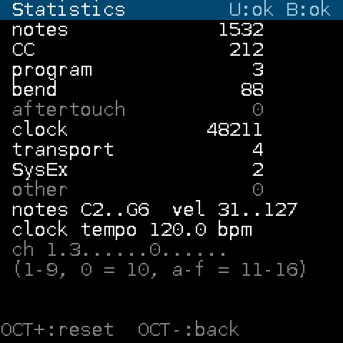

Counts since the last reset by kind of message, the note and velocity range seen,
the tempo estimated from incoming clock, and a strip showing which channels have
carried anything. Point a device at the FM-1, play for a minute, and this page tells
you what it actually sends. OCT+ resets the counts.

### Recorder

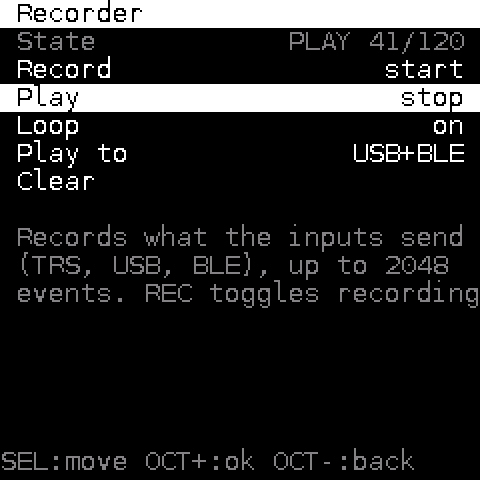

Records what arrives on the inputs, up to 2048 events with their timing, and plays
it back to USB, Bluetooth or both, once or looped. The REC and PLAY buttons toggle
recording and playback on this page when they have no MIDI job. Use it to send the
same phrase to two apps and compare, or as a scratch looper. SysEx is not recorded.

### MIDI reference

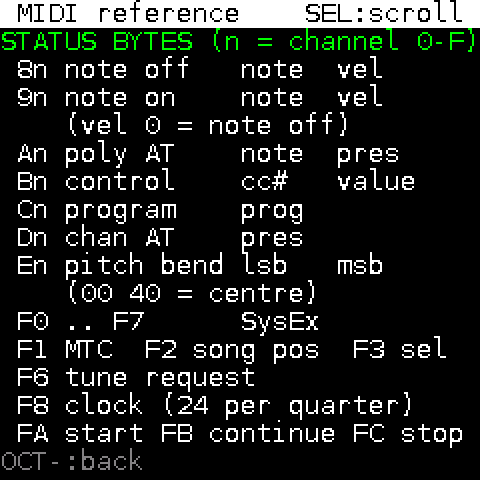

A pocket reference: the status bytes and their data, running status, the common
controller numbers, note numbers, the device inquiry exchange and the transports
this device uses. SELECT scrolls.

### Clock master

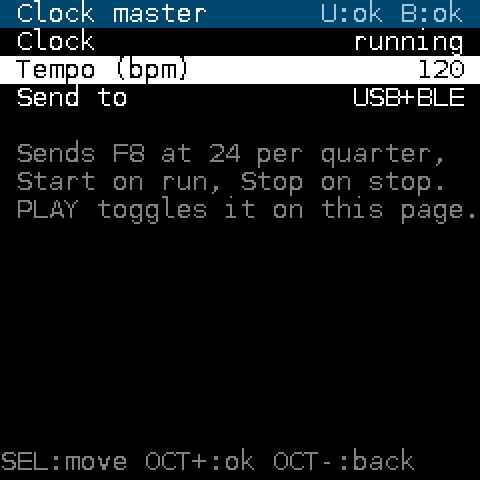

The FM-1 sends MIDI clock at a set tempo, 20 to 300 bpm, to USB, Bluetooth or both,
with Start when it runs and Stop when it stops. PLAY toggles it on this page. Timing
comes from the bridge's main loop, so expect a jitter of a couple of milliseconds;
good enough to drive an arpeggiator or a drum app, not a reference clock.

### Keyboard

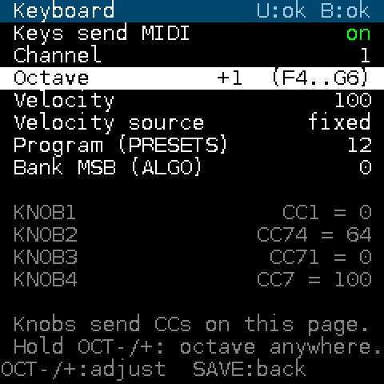
- On this page OCT- and OCT+ decrease and increase the highlighted row, and the
  highlight starts on *Octave*, so they shift the octave until you move it. Held, they
  shift the octave from any row. SAVE leaves, since OCT- is taken.
- *Keys send MIDI*: the 27 keys play notes (F3 to G5 at octave 0). Off silences them;
  keys and buttons with a MIDI job keep working.
- *Channel*, *Octave* (-3 to +3), *Velocity*.
- *Velocity source*: fixed, or the MASTER pot, which then sets the velocity of every
  note, 1 to 127 across its travel.
- *Program* and *Bank*: the PRESETS encoder sends program changes, ALGORITHM sends
  the bank select MSB.
- KNOB1 to KNOB4 send control changes 1, 74, 71 and 7 while this page is open.
  Elsewhere KNOB1 belongs to the menu.

### Button MIDI

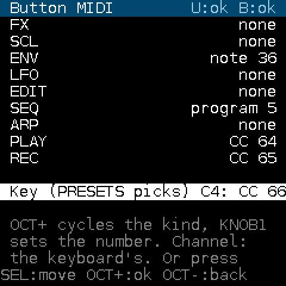
FX, SCL, ENV, LFO, EDIT, SEQ, ARP, PLAY and REC can each send nothing, a note, a
control change (127 when pressed, 0 when released) or a program change, on the
keyboard channel. OCT+ cycles the kind, KNOB1 sets the number. PLAY starts out as
CC 64, which many sheet-music apps accept as a page turn.

The *Key* row does the same for any of the 27 keys: turn PRESETS, or simply press a
key, to pick it. A key with a job no longer plays its note.

### Bluetooth

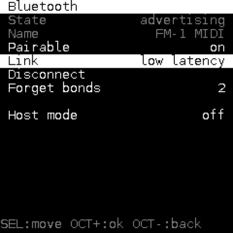

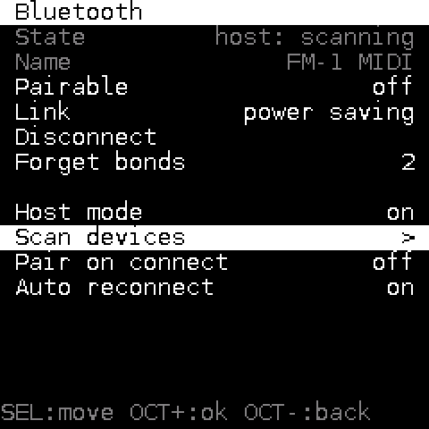

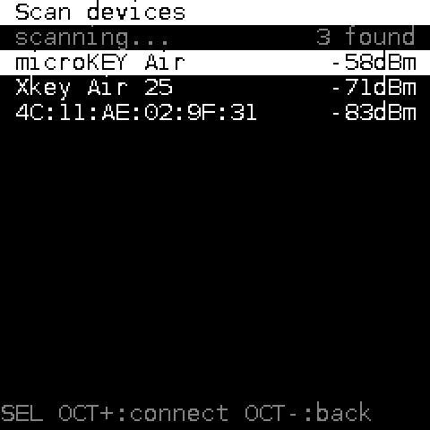
- *State*: advertising, connected, or the host mode state.
- *Pairable*: whether the FM-1 advertises. Off hides it from phones.
- *Link*: *low latency* asks for a 7.5 ms connection (Android) or 15 ms (Apple),
  *power saving* asks for 30 to 50 ms and lets the FM-1 skip events when idle. Power
  saving does not delay what the FM-1 sends, only what it receives. Hold GLO anywhere
  to switch.
- *Disconnect*, *Forget bonds* (the number shows how many devices are paired).
- *Host mode*: the FM-1 becomes the host and connects to a Bluetooth MIDI keyboard.
  While it is on, phones cannot connect. *Scan devices* lists MIDI devices in range
  with their signal (a device shows its address until its name has been heard); OCT+
  connects to the highlighted one. *Pair on connect* asks the keyboard to pair, which
  some require before they send anything; one that does not answer (Casio's WU-BT10 adapter) is used
  unpaired after 4 s. A keyboard reset or told to forget the FM-1 is forgotten in turn and paired
  again on the next connection. *Auto reconnect* remembers the last keyboard
  and looks for it again at power-on and after a drop, also while the Scan page is open;
  Disconnect switches that off until you connect by hand again. A keyboard that asks for
  a slow link gets it only in the power-saving link profile. If a boot never ran clean
  (twenty seconds up), the next one starts in the normal mode and the log says so: turn
  host mode on again by hand.

### USB

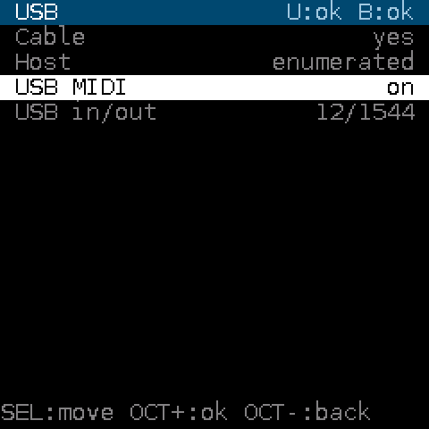
Cable present, whether the computer has enumerated the device, the *USB MIDI* switch
(off: the cable only charges) and the counters.

### MIDI filters

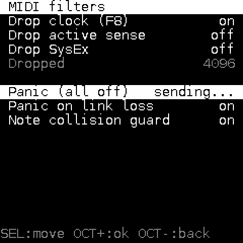
Drop clock, drop active sensing, drop SysEx, for every route at once. *Panic* sends
all sound off, all notes off and a note off for every note on every channel to USB
and Bluetooth. *Panic on link loss*: when USB or Bluetooth drops, the outputs still
connected get all notes off, so nothing stays stuck. *Note collision guard*: when two
sources send the same note to one output, a note held by one is not cut off by the
other's release, and a repeated note on retriggers cleanly instead of stacking.

### Presets

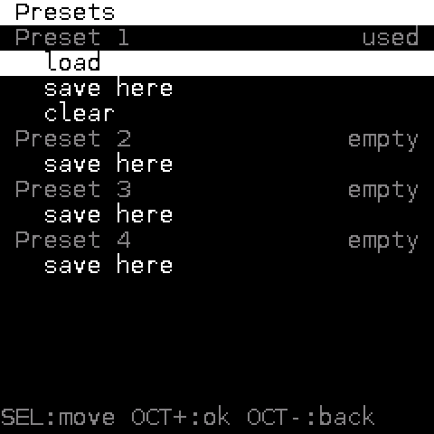

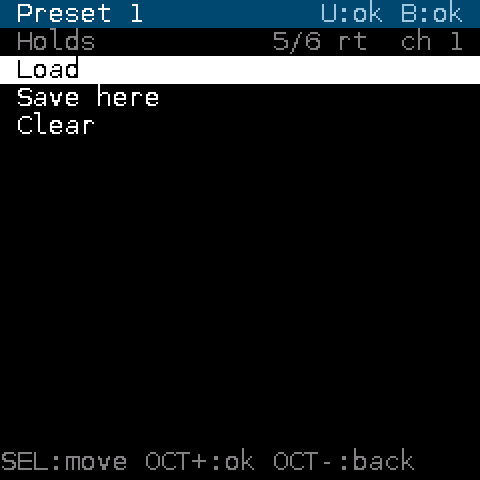

Four slots, each a snapshot of every setting (the Bluetooth pairings excepted). A
used slot's row says what it holds: how many of the six routes are on, the keyboard
channel, "host" and "eco" when set. OCT+ on a used slot loads it, on an empty slot
saves into it, after a confirmation. Hold OCT+ for the slot's own page: load, save
here, clear.

### Display

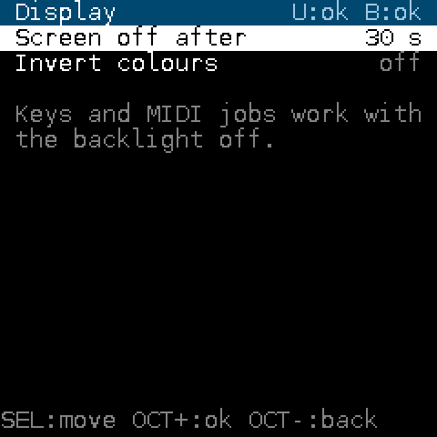
Screen off after never, 10 s, 30 s, 1 min or 5 min (the panel sleeps, its backlight stays lit: the backlight line also enables the key matrix); any press or knob turn wakes it, and that input does nothing else. The keys,
the knobs on the Keyboard page and every MIDI job keep working while the panel is
dark, so the first pedal press after a pause is never lost. Invert colours.

### System

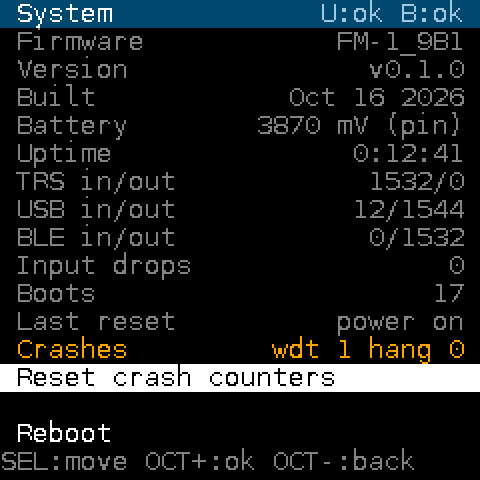

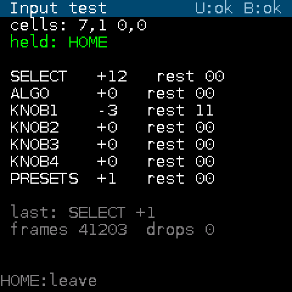

Firmware identity, version and build date, the battery (the cell voltage, estimated as twice the pin's, and the raw reading),
uptime, counters per port, input event drops, the boot count, why the chip last
reset (power on, software, watchdog, ...) and how many watchdog resets and bridge
stalls it has seen. If "Crashes" ever climbs, that is the first thing to report; the
row turns orange. *Reboot*. *USB recovery mode* restarts into the chip's USB download
mode, for M-VAVE's updater or a recovery tool. *Reset settings*. *Input test* shows
what the key scanner sees.

## Web editor

The screenshots above are renderings of the panel at twice its size; the real panel is 240 by 240 pixels.
Open `web/editor.html` from a local web server in Chrome or Edge, connect the FM-1 by
USB, click Connect. Every setting above is on one page, including channel sets, all
27 key jobs and the presets, and the page shows every MIDI message the FM-1 sends.
It also exports and imports the settings as a file, and installs a firmware package
over USB, the same way the command-line installer does. The Device card shows uptime,
free memory, task stack margins and the reset history, and the Device log card reads
the firmware's own log (boot, reset reason, update steps, Bluetooth connections), the
only console the FM-1 has. See `docs/web-editor.md`.

## Updating and going back
Updates install over USB MIDI with the installer in `tools/install.sh`, the same way
M-VAVE's updater works. To return to the original firmware, run M-VAVE's updater
with the official package; the bridge answers its handshake like the stock firmware
does. Keep the official package on your computer.

The first firmware to put on a new unit is the minimal build (`FM-1_930`): the
same updater and USB MIDI, a status screen, nothing else. It proves the install path
both ways before the full bridge goes on. Its screen has no menu and reads no keys:
the USB state, the TRS and USB counters, the boot count and reset reason, and the
uptime, refreshed once a second.

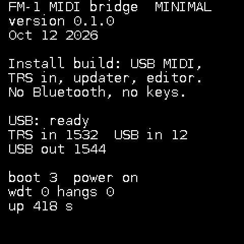

If the device ever stops answering, the System page's *USB recovery mode*, the
`tools/fm1_recover.py` script or, if the screen is dead, a USB recovery dongle,
brings the chip into its download mode, where `tools/fm1_flash.sh` restores a flash
dump. `docs/recovery.md` has the whole ladder and what to prepare beforehand.

## Settings
Settings are stored a second after a change and survive power cycles. Resetting
them, or loading a preset, applies at once. The Bluetooth pairing memory is kept
outside presets.

## Limits
- The 3.5 mm jack is an input only; the FM-1 cannot drive a hardware synth from it.
- Bluetooth host mode and the normal mode do not run at the same time.
- Keys have no velocity sensing; the keyboard sends the velocity set on its page.
- Latency: USB a few milliseconds, Bluetooth about 10 to 25 ms depending on the
  connection interval the other side grants.
